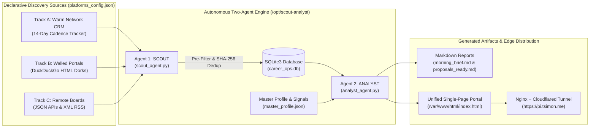

<div align="center">

# 🎯 Scout & Analyst — Autonomous Career Pipeline & Proposal Engine

**Declarative Multi-Platform Opportunity Ingestion, 100-Point Burnout-Safe Qualification & Trilingual (EN/FR/ES) Outreach Suite**

[](https://pi.tsimon.me)
[](https://pi.tsimon.me)
[](scout_agent.py)
[](#📄-license)

[](analyst_agent.py)
[](career_ops.db)
[](index.html)
[](index.html)
[](morning_brief.md)
[](https://pi.tsimon.me)
[](https://pi.tsimon.me)
[](install_schedules.sh)

---

[**Live Web Portal (`pi.tsimon.me`)**](https://pi.tsimon.me) · [**Unified HTML Dashboard (`index.html`)**](index.html) · [**Morning Briefing (`morning_brief.md`)**](morning_brief.md) · [**Trilingual Proposals (`proposals_ready.md`)**](proposals_ready.md) · [**RAG Knowledge Hub (`rag.tsimon.me`)**](https://rag.tsimon.me) · [**Author Website (`tsimon.me`)**](https://tsimon.me)

</div>

---

## 📌 Project Overview & Purpose

**Scout & Analyst** (`scout-analyst`) is a **zero-dependency, two-agent Python 3 career operations pipeline** engineered by **Thomas Simon** (La Paz, Bolivia · `UTC-4`). It completely eliminates manual job-board browsing by automating the discovery, pre-filtering, 100-point qualification, burnout guardrail enforcement, and trilingual (**English / French / Spanish**) proposal generation for fractional MSP/Cloud consulting, NOC/Centralized Services, and asynchronous AI evaluation roles.

It is designed around four core objectives:
1. **Declarative Multi-Platform Ingestion (`SCOUT`):** Poll JSON APIs, RSS feeds, DuckDuckGo search dorks across walled AI/freelance portals, and a cadence-driven Warm Network CRM without manual browsing or third-party dependencies.
2. **100-Point Qualification & Burnout Guardrail (`ANALYST`):** Score every opportunity against verified skills and metrics in [`master_profile.json`](master_profile.json) while automatically blocking toxic Tier 1 helpdesk, 24/7 on-call, or time-tracker surveillance roles.
3. **Grounded Trilingual Outreach (`EN / FR / ES`):** Generate ready-to-send proposals in English, French, and Spanish grounded 100% in verified enterprise metrics (13+ yrs IT, 6.5 yrs NOC/CSM, 30% recurring incident reduction).
4. **Hourly Edge Web Publishing (`Nginx` + `Cloudflared`):** Compile [`morning_brief.md`](morning_brief.md) and [`proposals_ready.md`](proposals_ready.md) into a single interactive [`index.html`](index.html) deployed automatically to `/var/www/html/index.html` and served globally via Cloudflare Tunnel at **[pi.tsimon.me](https://pi.tsimon.me)**.

---

## 🚀 Live Distribution & Edge Deployment

> [!IMPORTANT]
> **Live Cloudflared + Nginx Web Portal (`https://pi.tsimon.me`):**
> Every hour (`0 * * * *`), the pipeline polls all enabled sources, evaluates new leads, compiles both [`morning_brief.md`](morning_brief.md) and [`proposals_ready.md`](proposals_ready.md) into a single unified [`index.html`](index.html), and publishes it to Nginx's `/var/www/html/index.html` directory exposed via `cloudflared` tunnel at **[https://pi.tsimon.me](https://pi.tsimon.me)**.

| Component | Path / Endpoint | Status | Description |
| :--- | :--- | :---: | :--- |
| **Public Career Portal** | [`https://pi.tsimon.me`](https://pi.tsimon.me) |  | Public HTTPS entrypoint routed to local Nginx `/var/www/html/index.html` |
| **Unified Web Dashboard** | [`index.html`](index.html) → `/var/www/html/index.html` |  | Single-page HTML5/CSS3/JS dashboard combining Morning Brief, Proposals & Raw Markdown |
| **Agent 1: SCOUT** | [`scout_agent.py`](scout_agent.py) |  | Declarative multi-platform connector (`json_api`, `rss_feed`, `portal_dork`, `warm_crm`) |
| **Agent 2: ANALYST** | [`analyst_agent.py`](analyst_agent.py) |  | 100-point scoring engine, Burnout Guardrail, trilingual pitch generator & Nginx publisher |
| **SQLite State Store** | [`career_ops.db`](career_ops.db) |  | SHA-256 deduplicated opportunity ledger with scores, verdicts, and EN/FR/ES pitches |
| **Markdown Reports** | [`morning_brief.md`](morning_brief.md) · [`proposals_ready.md`](proposals_ready.md) |  | 3-minute daily executive briefing and copy-pasteable trilingual outreach pitches |

---

## 🏗️ System Architecture & Pipeline Workflow



---

## 📚 Exhaustive Module & Feature Matrix

### 1. Agent 1: SCOUT — Declarative Opportunity Ingestion ([`scout_agent.py`](scout_agent.py))

 Configured entirely via [`platforms_config.json`](platforms_config.json), `scout_agent.py` normalizes opportunities across three strategic tracks without requiring external scraping libraries:

| Connector Type | Strategic Track | Configured Platforms / Sources | Mechanism & Pre-Filtering Logic |
| :--- | :--- | :--- | :--- |
| **`warm_crm`** | **Track A:** Warm Network & Direct Outreach | Direct Consulting Network (`Mercedes`, `Rayan`, `Todd`, `Kevin`, `Liz`, `John`) | Tracks `last_contact` vs. `cadence_days` (14d) and auto-generates follow-up action items |
| **`portal_dork`** | **Track B & A:** Async AI Evaluation & Freelance Portals | `Outlier AI`, `Innodata`, `DataAnnotation`, `Alignerr`, `Mindrift`, `OneForma`, `Turing`, `Toptal`, `FlexJobs`, `Upwork` | Executes targeted DuckDuckGo Lite HTML search queries (`site:...`) to discover deep role URLs |
| **`json_api`** | **Track C:** Curated Remote Job Boards | `Working Nomads API`, `Remotive API`, `Jobicy SysAdmin API`, `RemoteOK JSON Feed` | Maps custom JSON schemas via declarative `field_mapping` and `json_root_key` definitions |
| **`rss_feed`** | **Track C:** Curated Remote Job Boards | `We Work Remotely (DevOps & Sysadmin RSS)` | Parses XML `<item>` feeds, cleans HTML descriptions, and extracts company/title pairs |

* **Global Noise Pre-Filter (`passes_global_pre_filter`):** Automatically drops roles containing `hard_exclude_keywords` (`tier 1 helpdesk`, `inbound call center`, `24/7 on-call`, `us citizens only`, `onsite only`, etc.) or `location_blacklist` terms, and requires at least one keyword match from `must_match_any_keyword`.
* **Deterministic Deduplication (`compute_hash`):** Computes a 24-character SHA-256 hash over normalized `title | company | url` so duplicate listings across runs are skipped in `O(1)` time.

---

### 2. Agent 2: ANALYST — 100-Point Scoring & Burnout Guardrail ([`analyst_agent.py`](analyst_agent.py))

Every queued opportunity in [`career_ops.db`](career_ops.db) is scored against [`master_profile.json`](master_profile.json) across four weighted dimensions:

| Dimension | Max Weight | Positive Signals & Multipliers | Penalties & Guardrail Triggers |
| :--- | :---: | :--- | :--- |
| **⚙️ Technical & Domain Fit** | **35 pts** | `liongard` (10), `it glue` (10), `centralized services` (10), `autotask` (9), `ninjaone` (9), `entra` (9), `backup radar` (9), `ai trainer` (9), `rlhf` (9), `evaluator` (9), `m365` (8), `azure` (8), `intune` (8), `powershell` (8), `power automate` (8), `bcdr` (8), `datto` (8), `linux`/`debian` (7) | Penalizes `-8 pts` per missing stack gap (`Terraform`, `Kubernetes`, `AWS`, `C#`, `React`, `Golang`) |
| **🛡️ Burnout & Autonomy Safety** | **25 pts** | Base `15 pts` + bonuses for `async`, `fractional`, `20 hours`, `self-paced`, `part-time`, `contract`, `documentation`, `automation`, `audit` | **Auto-SKIP Guardrail:** Triggers immediate `SKIP` verdict if any un-negated red flag hits (`tier 1`, `helpdesk`, `on-call`, `24/7`, `pager`, `inbound calls`, `phone support`, `time tracker screenshot`, `micromanage`) or safety score `< 8` |
| **🌎 Bolivia (`UTC-4`) & Trilingual Fit** | **20 pts** | Base `12 pts` + `+5 pts` for `Bolivia`, `LATAM`, `Americas`, `UTC-4`, `Worldwide`/`Global` + `+5 pts` for `Spanish`, `French`, `Bilingual`, `Trilingual`, `Andean` | Standard baseline (`12/20`) when neither region nor multilingual bonus is explicitly stated |
| **⏱️ Contract & Compensation Fit** | **20 pts** | Base `12 pts` + `+8 pts` for `20 hrs`, `part-time`, `fractional`, `contract`, `async`, `self-paced`, `warm_lead` | `-6 pts` penalty if listed as `full-time` without `contract` flexibility |

#### Verdict Thresholds
* 🔥 **`APPLY` (`>= 80 / 100`):** High-signal match aligned with tech stack, autonomy, and Bolivia `UTC-4` workflow. Generates tailored **EN / FR / ES** proposals.
* 🟡 **`POSSIBLE` (`62 – 79 / 100`):** Viable opportunity requiring positioning around existing M365/Azure/MSP/SysOps strengths. Generates tailored **EN / FR / ES** proposals.
* 🛡️ **`SKIP` (`< 62 / 100` or Burnout Red Flag):** Blocked automatically by the Burnout & ROI Guardrail; zero action required.

---

### 3. Unified Single-Page Web Dashboard (`index.html` → `/var/www/html/index.html`)

[`analyst_agent.py`](analyst_agent.py) compiles all results into a single self-contained [`index.html`](index.html) featuring:
- **Interactive View Switcher:** Switch seamlessly between **☕ Morning Brief**, **✍️ Proposals Ready (EN/FR/ES)**, and **📄 Raw Markdown (`.md`)** without page reloads.
- **Live Filtering & Instant Search:** Filter cards by verdict (`All`, `🔥 APPLY`, `🟡 POSSIBLE`, `🛡️ SKIP`) or search across skills, companies, and tracks in real time.
- **Inline & Dedicated Trilingual Proposal Drawers:** Toggle **🇬🇧 English**, **🇫🇷 Français**, **🇪🇸 Español**, or **🌐 Show All 3** pitches directly inside any Morning Brief card or in the Proposals view, complete with **1-click clipboard copy buttons**.
- **Responsive Sidebar & Mobile Hamburger Navigation:** Fixed left sidebar (`300px`) on desktop and collapsible top navigation bar on mobile (`<= 800px`).

---

## 📂 Repository Directory Structure

```text
scout-analyst/
├── scout_agent.py                # Agent 1: Declarative multi-platform ingestion & pre-filtering CLI
├── analyst_agent.py              # Agent 2: 100-pt qualification, trilingual pitch generator & Nginx publisher
├── platforms_config.json         # Declarative platform connectors, keywords, blacklists & Warm CRM contacts
├── master_profile.json           # Verified experience metrics, skills matrix, scoring weights & tunnel config
├── career_ops.db                 # SQLite3 opportunity database (deduplicated via SHA-256 job_hash)
├── index.html                    # Unified HTML5/CSS3/JS dashboard (copied to /var/www/html/index.html)
├── morning_brief.md              # Generated Markdown daily executive briefing
├── proposals_ready.md            # Generated Markdown trilingual (EN/FR/ES) outreach proposals
├── install_schedules.sh          # Linux cron installer (hourly execution + /var/www/html/index.html sync)
├── install_schedules.ps1         # Windows Task Scheduler installer (08:30 AM pipeline + 08:45 AM portal open)
├── pipeline.log                  # Execution log output from scheduled cron runs
└── README.md                     # Repository documentation (this file)
```

---

## 🛠️ CLI Usage & Declarative Management

### 1. Run the Full Pipeline Manually

```bash
cd /opt/scout-analyst

# Step 1: Poll all enabled platforms and queue new leads into career_ops.db
python3 scout_agent.py run

# (Optional) Seed realistic Track A/B/C demo opportunities for offline testing
python3 scout_agent.py run --demo

# Step 2: Score leads, generate morning_brief.md, proposals_ready.md, and publish index.html to /var/www/html
python3 analyst_agent.py --run --web-dir /var/www/html
```

### 2. Declaratively Add Platforms, Keywords, or Warm CRM Contacts via CLI

You never need to edit Python code to expand your pipeline:

```bash
# List all declared platforms and status
python3 scout_agent.py list

# Add a new JSON API, RSS feed, or DuckDuckGo portal dork
python3 scout_agent.py add-platform \
  --name "Cloudflare Remote Jobs Dork" \
  --type portal_dork \
  --url "https://www.cloudflare.com/careers/" \
  --track "Track C: Curated Remote Boards" \
  --query 'site:cloudflare.com ("Systems Engineer" OR "Cloud" OR "Remote")'

# Add a new must-match target keyword or hard-exclude keyword
python3 scout_agent.py add-keyword "proxmox"
python3 scout_agent.py add-keyword "on-site only" --exclude

# Add a contact to the Warm Network CRM tracker
python3 scout_agent.py add-contact \
  --name "Alex" \
  --focus "Fractional M365 & Entra ID Hardening" \
  --status "Ready for initial outreach" \
  --cadence 14
```

---

## ⏰ Automated Hourly Cron Schedule (`Linux` / `Nginx` / `Cloudflared`)

To run the complete **SCOUT + ANALYST** pipeline every hour at minute `0` and publish the resulting [`index.html`](index.html) into Nginx's `/var/www/html` directory (served publicly at **[https://pi.tsimon.me](https://pi.tsimon.me)**):

### Option A: Automated Installer Script
```bash
chmod +x /opt/scout-analyst/install_schedules.sh
/opt/scout-analyst/install_schedules.sh
```

### Option B: Direct `crontab -e` Entry
```cron
0 * * * * cd /opt/scout-analyst && /usr/bin/python3 scout_agent.py run && /usr/bin/python3 analyst_agent.py --run --web-dir /var/www/html && cp -f /opt/scout-analyst/index.html /var/www/html/index.html >> /opt/scout-analyst/pipeline.log 2>&1
```

---

## 👤 Author & Contact

**Thomas Simon** — *Senior Systems, Cloud (M365 / Azure / Entra ID) & MSP Automation Consultant*
- 🌐 **Professional Portfolio:** [tsimon.me](https://tsimon.me)
- 🎯 **Live Scout & Analyst Portal:** [pi.tsimon.me](https://pi.tsimon.me)
- 🧠 **Edge RAG Knowledge Hub:** [rag.tsimon.me](https://rag.tsimon.me)
- 📧 **Email:** [simon_thomas@outlook.fr](mailto:simon_thomas@outlook.fr)
- 💻 **GitHub:** [@t0m-a](https://github.com/t0m-a)
- 🐳 **Docker Hub:** [simonthomas](https://hub.docker.com/u/simonthomas/)
- 🔗 **LinkedIn:** [Thomas Simon](https://www.linkedin.com/in/thomas-simon-bolivie/?locale=en_US)
- 🐦 **Twitter / X:** [@7ohms](https://twitter.com/7ohms)

---

## 📄 License

This project is licensed under the **GNU General Public License v3.0 (GPL-3.0)**.
