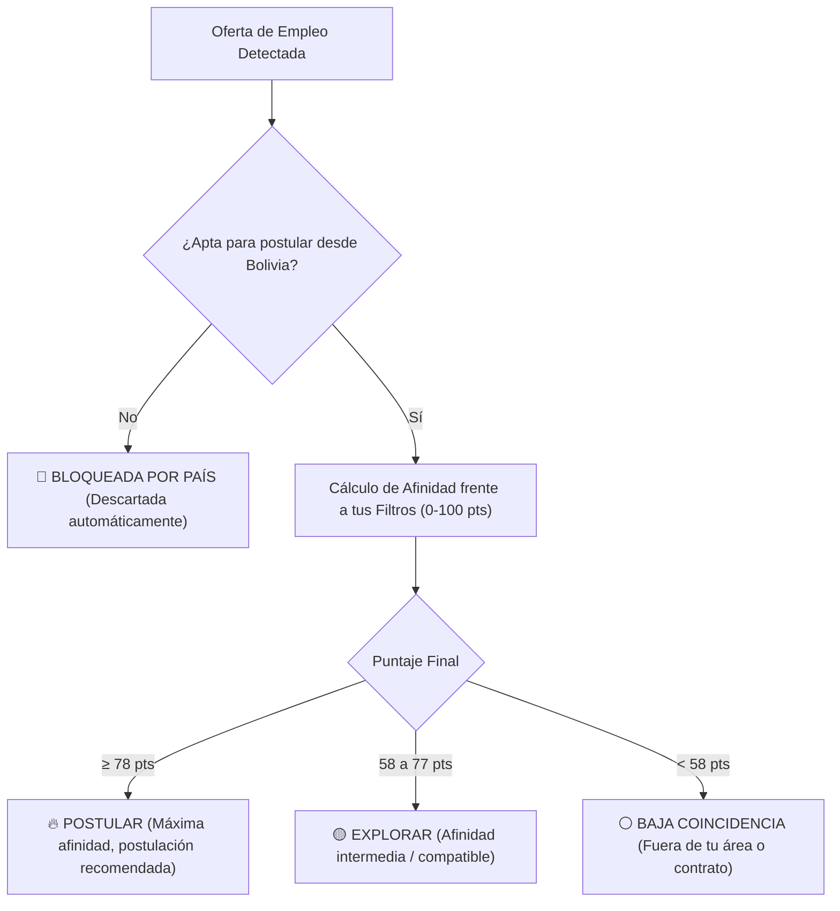
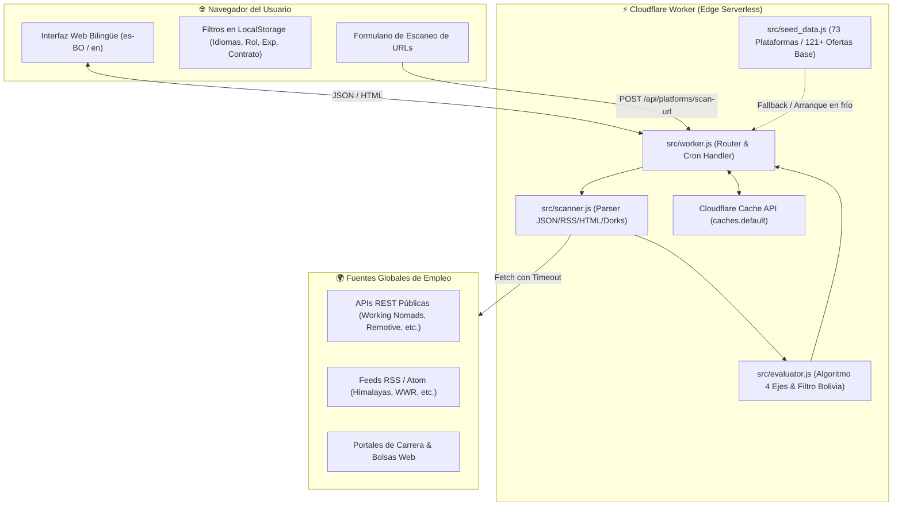

<div align="center">

# 🇧🇴 Buscador y Evaluador de Empleos 100% Remotos desde Bolivia

**Plataforma pública, autónoma y auto-contenida para Cloudflare Workers diseñada para encontrar, filtrar y evaluar ofertas laborales internacionales elegibles para trabajar desde Bolivia (UTC-4).**

[](src/worker.js)
[](wrangler.toml)
[](wrangler.toml)
[](src/ui.js)
[](#-licencia)

<p align="center">
  <a href="#-manual-del-usuario-final"><b>Manual de Usuario</b></a> •
  <a href="#-c%C3%B3mo-funciona-la-arquitectura-interna"><b>Arquitectura Interna</b></a> •
  <a href="#-gu%C3%ADa-de-instalaci%C3%B3n-y-auto-alojamiento-self-hosting"><b>Guía de Auto-Alojamiento</b></a> •
  <a href="#-referencia-de-la-api-rest"><b>API REST</b></a>
</p>

</div>

---

## 🧭 Tabla de Contenidos

1. [💡 ¿Qué es esta plataforma?](#-qu%C3%A9-es-esta-plataforma)
2. [📖 Manual del Usuario Final](#-manual-del-usuario-final)
   - [Paso 1: Acceso e idioma](#paso-1-acceso-e-idioma)
   - [Paso 2: Configuración de tus filtros personalizados](#paso-2-configuraci%C3%B3n-de-tus-filtros-personalizados)
   - [Paso 3: El filtro base — ¿Por qué 100% Remoto desde Bolivia?](#paso-3-el-filtro-base--por-qu%C3%A9-100-remoto-desde-bolivia)
   - [Paso 4: Semáforo de calificación y toma de acción](#paso-4-sem%C3%A1foro-de-calificaci%C3%B3n-y-toma-de-acci%C3%B3n)
   - [Paso 5: Escanear y evaluar URLs de plataformas personalizadas](#paso-5-escanear-y-evaluar-urls-de-plataformas-personalizadas)
   - [Paso 6: Generación y descarga de resultados en vivo](#paso-6-generaci%C3%B3n-y-descarga-de-resultados-en-vivo)
3. [⚙️ Cómo Funciona la Arquitectura Interna](#-c%C3%B3mo-funciona-la-arquitectura-interna)
   - [Diagrama de flujo del sistema](#diagrama-de-flujo-del-sistema)
   - [Motor de calificación y rúbrica dinámica de 100 puntos](#motor-de-calificaci%C3%B3n-y-r%C3%BAbrica-din%C3%A1mica-de-100-puntos)
   - [Motor de ingesta y detección automática de feeds](#motor-de-ingesta-y-detecci%C3%B3n-autom%C3%A1tica-de-feeds)
   - [Ciclo de ejecución bajo demanda y cron cada 15 minutos](#ciclo-de-ejecuci%C3%B3n-bajo-demanda-y-cron-cada-15-minutos)
4. [🛠️ Guía de Instalación y Auto-Alojamiento (Self-Hosting)](#-gu%C3%ADa-de-instalaci%C3%B3n-y-auto-alojamiento-self-hosting)
   - [Requisitos previos](#requisitos-previos)
   - [Instalación local y pruebas](#instalaci%C3%B3n-local-y-pruebas)
   - [Despliegue público en Cloudflare Workers](#despliegue-p%C3%BAblico-en-cloudflare-workers)
   - [Generación de HTML autónomo (Standalone)](#generaci%C3%B3n-de-html-aut%C3%B3nomo-standalone)
5. [🔌 Referencia de la API REST](#-referencia-de-la-api-rest)
6. [📄 Licencia](#-licencia)

---

## 💡 ¿Qué es esta plataforma?

Buscar trabajo remoto internacional desde Bolivia suele ser frustrante: la mayoría de bolsas de empleo anuncian puestos como *"remotos"*, pero al leer las letras pequeñas exigen residencia física en Estados Unidos, permiso de trabajo en la Unión Europea o contratación exclusiva local.

Esta herramienta es una **solución pública y gratuita** que centraliza más de **73 plataformas globales y regionales**, filtrando automáticamente el ruido geográfico y evaluando cada oportunidad frente a tus preferencias individuales de **idiomas, tipo de puesto, nivel de experiencia y modalidad de contrato**.

> [!NOTE]
> Todo el procesamiento ocurre en tiempo real en los servidores perimetrales de **Cloudflare Workers**. No almacena información privada ni perfiles predeterminados: tú tienes el control total de lo que buscas.

---

## 📖 Manual del Usuario Final

Si estás utilizando la versión alojada públicamente en línea, esta guía te muestra cómo aprovecharla al máximo en menos de 3 minutos.

```
┌─────────────────────────────────────────────────────────────────────────────┐
│ 1. Elige tu Idioma ──▶ 2. Ajusta tus Filtros ──▶ 3. Revisa tu Semáforo       │
│    (ES-BO / EN)         (Rol, Exp, Contrato)       (Postular / Explorar)    │
│                                                                             │
│ 4. ¿Tienes una URL? ─▶ 5. Escanéala en Vivo  ──▶ 6. Exporta tu Reporte      │
│    (Pega cualquier link)  (Evaluación instantánea)  (Markdown / CSV)        │
└─────────────────────────────────────────────────────────────────────────────┘
```

### Paso 1: Acceso e idioma

Al abrir el portal, la aplicación carga por defecto en **Español (Bolivia)** (`es-BO`). 

Si prefieres navegar en inglés, haz clic en el botón superior derecho:
- **`🇧🇴 Español (Bolivia)`**: Textos, etiquetas y reportes orientados a la región.
- **`🇬🇧 English`**: Traducción completa de la interfaz y del reporte en formato Markdown.

---

### Paso 2: Configuración de tus filtros personalizados

En la sección **"🎛️ Personaliza tu Búsqueda y Criterios de Evaluación"**, puedes seleccionar tus preferencias haciendo clic sobre las etiquetas interactivas:

| Filtro | Opciones Disponibles | Cómo Influye en el Puntaje |
| :--- | :--- | :--- |
| **1. Tus Idiomas** | `Español (BO)`, `Inglés`, `Francés`, `Portugués` | Pondera hasta **15 puntos**. Si dominas español e inglés, la plataforma prioriza ofertas abiertas a talento bilingüe. |
| **2. Tu Nivel de Experiencia** | `Todos los niveles`, `Inicial / Sin experiencia (0-1 a)`, `Junior (1-2 a)`, `Semi-Senior / Mid (3-5 a)`, `Senior (5+ a)`, `Lead / Manager (8+ a)` | Pondera dentro del bloque de contrato/experiencia (**20 puntos**). Evita que veas vacantes incompatibles con tu trayectoria. |
| **3. Tipo de Contrato** | `Tiempo Completo (40h/sem)`, `Medio Tiempo / Part-Time (20h / 4 días)`, `Por Proyectos / Freelance`, `Por Horas / Flexible / Asíncrono`, `Consultoría / Asesoría` | Puedes marcar uno, varios o todos. Pondera dentro del bloque de contrato (**20 puntos**). |
| **4. Tipo de Posición** | `Desarrollo de Software, Web & QA`<br>`Cloud, DevOps, SRE & Sistemas TI`<br>`Entrenamiento de IA, RLHF & Evaluación`<br>`Datos, SQL, BI & Machine Learning`<br>`Ciberseguridad & Redes`<br>`Soporte Técnico & Atención al Cliente`<br>`Gestión, Producto, Ventas & Consultoría`<br>`Diseño, CAD/CFD, Redacción & Otros` | Pondera hasta **40 puntos**. Puedes marcar una o múltiples categorías. Si deseas ver todas las ofertas sin restricción de rol, haz clic en *"Ver todas las áreas"*. |
| **Palabras Clave Libres** | Campo de texto abierto para escribir tecnologías o puestos específicos (ej. *Python, React, Soporte, SQL, Azure, QA*). | Las ofertas que contengan estas palabras recibirán una bonificación directa en su calificación. |

> [!TIP]
> **Casilla "Ocultar ofertas de otras áreas":**  
> Si marcas esta opción, el sistema actuará con filtro estricto y esconderá cualquier oferta que no coincida con tus áreas seleccionadas.

---

### Paso 3: El filtro base — ¿Por qué 100% Remoto desde Bolivia?

La casilla **"🇧🇴 Mostrar solo ofertas 100% remotas desde Bolivia"** viene activada por defecto. 

#### ¿Qué hace este filtro?
El algoritmo analiza el texto completo de la oferta, su título, ubicación requerida y políticas de contratación para descartar automáticamente:
- Puestos que requieren residir físicamente en Estados Unidos (*"US Only"*, *"Must reside in the US"*, contratos *W-2* exclusivos).
- Puestos restringidos a Europa (*"EU Only"*), Reino Unido (*"UK Only"*), México, España o Francia.
- Empleos presenciales o híbridos (*"On-site"*, *"Hybrid"*).
- Posiciones que exigen autorizaciones de seguridad gubernamental extranjera (*"Security Clearance"*, *"TS/SCI"*).

#### ¿Qué oportunidades mantiene visibles?
- **🌎 Específicas para Latinoamérica y Bolivia:** Empresas que contratan activamente en Sudamérica, zona horaria `UTC-4` / `EST` o mediante contrato internacional (*W-8BEN* sin visa).
- **🌍 100% Remoto Global / Work From Anywhere:** Compañías distribuidas en todo el mundo sin barrera geográfica de residencia.
- **🕒 Traslape Horario Internacional:** Ofertas que aceptan trabajo internacional requiriendo coincidencia horaria razonable.

---

### Paso 4: Semáforo de calificación y toma de acción

Cada vacante es calificada sobre **100 puntos** y clasificada en cuatro grupos:



1. **🔥 POSTULAR (Puntaje ≥ 78/100):**  
   Coincide con tus idiomas, tu área profesional, tu nivel y es 100% accesible desde Bolivia. Incluye el botón **"🔗 Ver Oferta y Postular"** para abrir el enlace directo a la fuente original.
2. **🟡 EXPLORAR (Puntaje 58–77/100):**  
   Ofertas interesantes que coinciden con tus habilidades principales, pero presentan variaciones menores (por ejemplo, modalidad de tiempo completo cuando buscas medio tiempo, o nivel semi-senior).
3. **⚪ BAJA COINCIDENCIA (< 58/100):**  
   Ofertas legítimas desde Bolivia, pero fuera de las categorías o palabras clave que seleccionaste.
4. **🚫 NO ELEGIBLES BOLIVIA:**  
   Vacantes detectadas con restricciones geográficas locales. Puedes visualizarlas seleccionando la pestaña *"Bloqueadas País"* si tienes curiosidad de saber qué fue descartado y por qué motivo.

---

### Paso 5: Escanear y evaluar URLs de plataformas personalizadas

¿Encontraste una página de carreras de una empresa, una nueva bolsa de empleo o un enlace de ofertas remotas que quieres evaluar?

1. Dirígete a la sección **"➕ Agregar y Escanear tu Propia URL de Plataforma o Bolsa de Empleo"**.
2. Pega la URL en el campo correspondiente (por ejemplo: `https://empresa.com/careers` o `https://sitio.com/jobs.rss`).
3. *(Opcional)* Asigna un nombre descriptivo.
4. Selecciona el modo de escaneo:
   - **Auto-detectar (Recomendado):** Detecta automáticamente si el enlace es una página HTML con microdatos de empleo (*JSON-LD JobPosting*), un feed RSS/Atom en XML, o un endpoint JSON.
   - **Página Web / Bolsa HTML:** Rastrea enlaces y fichas de empleo dentro de la estructura web.
   - **Feed RSS / Atom XML:** Extrae las entradas publicadas en sindicación.
   - **API JSON:** Lee listas de vacantes expuestas en formato REST/JSON.
5. Haz clic en **"🔍 Escanear y Evaluar URL"**.
6. En segundos, las oportunidades encontradas serán analizadas con el filtro de Bolivia y tus criterios, integrándose inmediatamente a tus **Resultados**.

---

### Paso 6: Generación y descarga de resultados en vivo

La aplicación no depende de boletines estáticos ni horarios rígidos: los resultados se generan al vuelo (*on-the-fly*):

- **Vista "📄 Reporte Markdown / Exportar":**  
  Genera un informe completo en formato Markdown (`.md`) con el resumen de vacantes recomendadas, desgloses de puntaje y enlaces directos.
- **Botón `📋 Copiar Resultados (.md)`:** Copia el reporte formateado a tu portapapeles.
- **Botón `⬇️ Descargar .md`:** Descarga el archivo `resultados-remoto-bolivia-YYYY-MM-DD.md`.
- **Botón `📊 Exportar CSV`:** Descarga una hoja de cálculo con todas las ofertas, empresas, ubicaciones, modalidades y enlaces para que lleves control de tus postulaciones en Excel o Notion.
- **Botón `🔄 Escanear Ofertas Ahora`:** En la cabecera superior, pulsa este botón cuando quieras solicitar a la red de Cloudflare un escaneo en vivo de las plataformas activas.

---

## ⚙️ Cómo Funciona la Arquitectura Interna

La solución está construida sobre una arquitectura **Serverless Zero-Dependency** en **Cloudflare Workers**, consumiendo únicamente estándares de la Web (Fetch API, Web Streams, Web Crypto, URL API, Cache API).

### Diagrama de flujo del sistema



---

### Motor de calificación y rúbrica dinámica de 100 puntos

El evaluador ([`src/evaluator.js`](src/evaluator.js)) analiza cada oportunidad descomponiéndola en 4 dimensiones ponderadas:

$$\text{Puntaje Total} = \text{Posición y Habilidades (40)} + \text{Elegibilidad Bolivia (25)} + \text{Contrato y Nivel (20)} + \text{Idiomas (15)}$$

```
  ┌───────────────────────────────────────────────────────────────┐
  │ 🎯 Posición & Habilidades: 40 pts                             │
  │   - Coincidencia con categoría profesional seleccionada       │
  │   - Coincidencia con palabras clave libres del usuario        │
  │                                                               │
  │ 🇧🇴 Elegibilidad Remota Bolivia: 25 pts                        │
  │   - 25 pts: Explícitamente Bolivia / LATAM / UTC-4            │
  │   - 23 pts: Remoto Global / Work From Anywhere                │
  │   - 19 pts: Remoto internacional con traslape horario         │
  │   -  0 pts: Restringido a país local (descarta la vacante)    │
  │                                                               │
  │ ⏱️ Modalidad de Contrato & Experiencia: 20 pts                │
  │   - Contrato buscado: Full-time, Half-time, Proyectos, Horas  │
  │   - Nivel de experiencia requerido vs declarado               │
  │                                                               │
  │ 🗣️ Idiomas Requeridos: 15 pts                                 │
  │   - Coincidencia con el repertorio lingüístico del usuario    │
  └───────────────────────────────────────────────────────────────┘
```

---

### Motor de ingesta y detección automática de feeds

El escáner ([`src/scanner.js`](src/scanner.js)) implementa un procesador adaptativo de fuentes sin requerir librerías pesadas:

1. **APIs JSON:** Inspecciona dinámicamente claves comunes (`jobs`, `results`, `data`, `items`) y mapea campos de título, empresa, descripción, ubicación y enlace.
2. **Feeds XML (RSS 2.0 y Atom 1.0):** Parser mediante expresiones regulares optimizadas y sanitización de entidades HTML (`&amp;`, `&lt;`, `<![CDATA[...]]>`).
3. **Páginas Web HTML:**
   - Extrae bloques estructurados de Schema.org (`<script type="application/ld+json">` con `@type: "JobPosting"`).
   - Analiza patrones de enlaces que contengan rutas de empleo (`/jobs/`, `/careers/`, `/roles/`, `/apply/`) con títulos semánticos.
4. **Protección contra plataformas inactivas:** Incluye un disyuntor (*circuit breaker*) que descarta dominios extintos o dados de baja.

---

### Ciclo de ejecución bajo demanda y cron cada 15 minutos

La plataforma combina dos modos de refresco:

- **Automático en segundo plano (Cloudflare Cron Trigger):**  
  Declarado en [`wrangler.toml`](wrangler.toml) como `crons = ["*/15 * * * *"]`. Cada 15 minutos, el worker despierta sin costo de servidor dedicado, sondea un lote rotativo de plataformas y persiste las nuevas vacantes elegibles en la memoria caché perimetral.
- **Bajo demanda del usuario:**  
  La interfaz gráfica realiza llamadas a `/api/scan` y `/api/platforms/scan-url` permitiendo que cualquier persona desencadene una actualización instantánea en el momento exacto en que la necesita.

---

## 🛠️ Guía de Instalación y Auto-Alojamiento (Self-Hosting)

Puedes alojar tu propia instancia en Cloudflare en menos de 5 minutos utilizando una cuenta gratuita.

### Requisitos previos

- **Node.js** v20.0.0 o superior ([nodejs.org](https://nodejs.org/)).
- **Cuenta de Cloudflare** gratuita ([dash.cloudflare.com](https://dash.cloudflare.com/)).
- **Git** instalado en tu sistema.

---

### Instalación local y pruebas

1. **Clonar el repositorio:**
   ```bash
   git clone https://github.com/t0m-a/scout-analyst-pipeline.git
   cd scout-analyst-pipeline
   ```

2. **Verificar la suite de pruebas automatizadas:**
   ```bash
   npm test
   ```
   *Esta prueba valida la carga de la interfaz, los endpoints del worker, la precisión del filtro geográfico de Bolivia y la ausencia de datos privados.*

3. **Iniciar el servidor local de desarrollo con Wrangler:**
   ```bash
   npm run dev
   ```
   Wrangler levantará la aplicación en `http://localhost:8787`, simulando de forma idéntica el entorno de Cloudflare Workers.

---

### Despliegue público en Cloudflare Workers

1. **Iniciar sesión en tu cuenta de Cloudflare desde la terminal:**
   ```bash
   npx wrangler login
   ```

2. **Publicar el Worker a nivel mundial:**
   ```bash
   npm run deploy
   ```

   Una vez finalizado, la consola mostrará tu URL pública activa, por ejemplo:
   ```text
   Uploaded bolivia-remote-scout (2.1 sec)
   Deployed bolivia-remote-scout triggers (1.0 sec)
     https://bolivia-remote-scout.<tu-subdominio>.workers.dev
     schedule: */15 * * * *
   ```

> [!IMPORTANT]
> **El Cron Trigger queda activo automáticamente:**  
> Al desplegar, Cloudflare programa la ejecución del escaneo cada 15 minutos sin que tengas que configurar tareas de cron en Linux ni administradores de tareas en Windows.

---

### Generación de HTML autónomo (Standalone)

Si deseas utilizar la interfaz como un archivo HTML único sin desplegar el Worker (por ejemplo, para abrirlo localmente en tu navegador o alojarlo en GitHub Pages / Nginx):

```bash
npm run build-html
```

Este comando empaqueta los datos base y el evaluador directamente dentro de [`index.html`](index.html), permitiendo abrir el archivo en cualquier navegador con doble clic.

---

## 🔌 Referencia de la API REST

El worker expone endpoints HTTP estándar para integraciones externas:

| Método | Ruta | Parámetros / Cuerpo | Descripción |
| :--- | :--- | :--- | :--- |
| `GET` | `/` | Ninguno | Retorna la aplicación web interactiva completa (HTML5/CSS3/JS). |
| `GET` | `/api/state` | Ninguno | Retorna el listado completo de plataformas registradas y ofertas actuales en JSON. |
| `POST` | `/api/evaluate` | JSON `{ filters: { ... } }` | Evalúa dinámicamente el catálogo frente a los filtros provistos y retorna las ofertas ordenadas con sus puntajes. |
| `POST` | `/api/scan` | JSON opcional `{ track, platform }` | Ejecuta un escaneo de actualización bajo demanda sobre las plataformas monitoreadas. |
| `POST` | `/api/platforms/scan-url` | JSON `{ url, name, type, track, filters }` | Escanea cualquier URL ingresada por el usuario, extrae ofertas y las añade a la base. |
| `GET` | `/api/results.md` | Query: `?lang=es` o `?lang=en` | Genera y descarga el reporte de Resultados al instante en formato Markdown puro. |

#### Ejemplo con `curl`: Escaneo de una URL personalizada
```bash
curl -X POST https://bolivia-remote-scout.workers.dev/api/platforms/scan-url \
  -H "Content-Type: application/json" \
  -d '{
    "url": "https://remotive.com/api/remote-jobs?category=devops&limit=10",
    "name": "Remotive DevOps Feed",
    "type": "json_api"
  }'
```

---

## 📄 Licencia

Este proyecto es software libre y de código abierto bajo la licencia **GNU General Public License v3.0 (GPL-3.0)**. Eres libre de usarlo, estudiarlo, compartirlo y mejorarlo para beneficiar a la comunidad.

---

<div align="center">
  <sub>Construido con tecnología de borde en Cloudflare Workers para impulsar oportunidades de empleo remoto desde Bolivia hacia el mundo.</sub>
</div>
